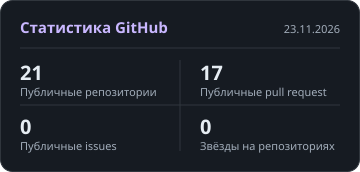

<h1 align="center">AlexGoster · Python Backend</h1>

REST API, фоновые задачи и CI/CD

  

  

  

  <picture>
    <source media="(prefers-color-scheme: dark)" srcset="https://raw.githubusercontent.com/AlexGoster/AlexGoster/snake/snake-dark.svg">
    
  </picture>

## Избранные проекты

| Проект | Что внутри |
| --- | --- |
| [OrderFlow Core](https://github.com/AlexGoster/orderflow-core) | API заказов на FastAPI с асинхронным SQLAlchemy, PostgreSQL и миграциями Alembic |
| [OrderFlow Jobs](https://github.com/AlexGoster/orderflow-jobs) | Фоновые и периодические задачи на Celery и Redis с отслеживанием статусов и повторными попытками |
| [OrderFlow Platform](https://github.com/AlexGoster/orderflow-platform) | CI/CD, развёртывание с откатом и мониторинг на Prometheus и Grafana |
| [Deribit Price API](https://github.com/AlexGoster/deribit-price-api) | API для получения цен Deribit |
